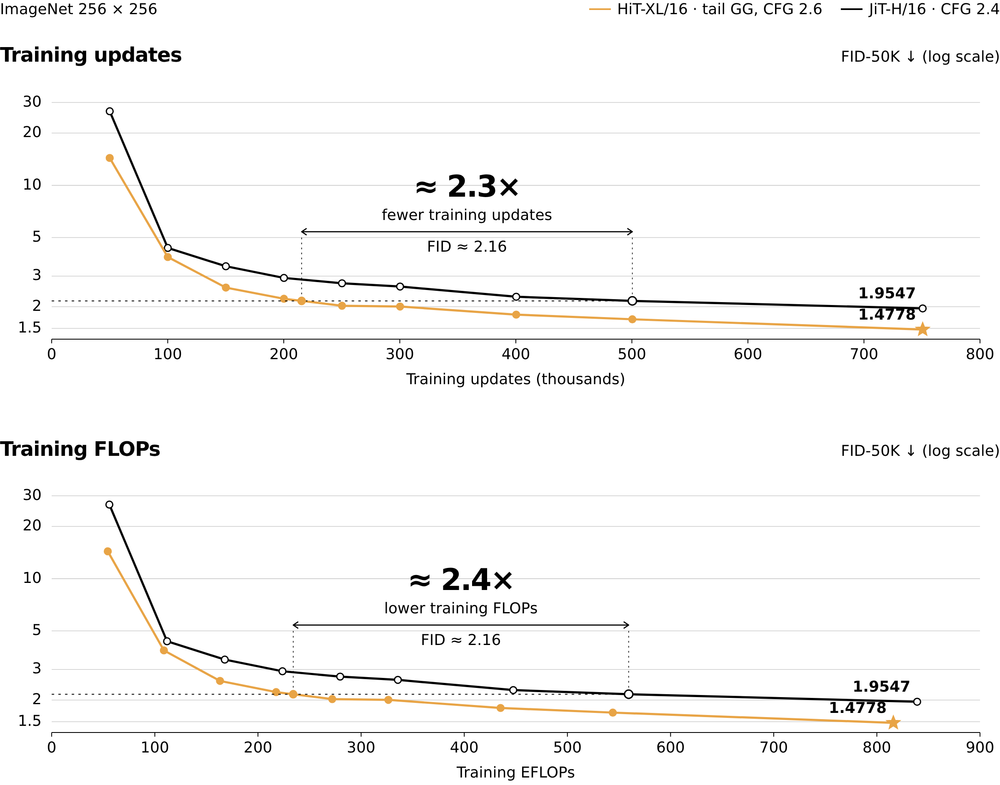
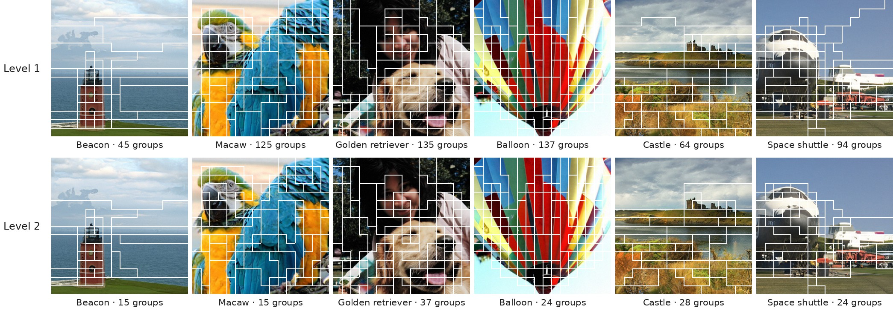
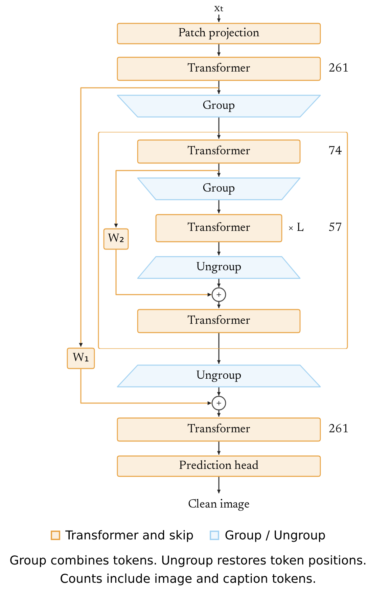
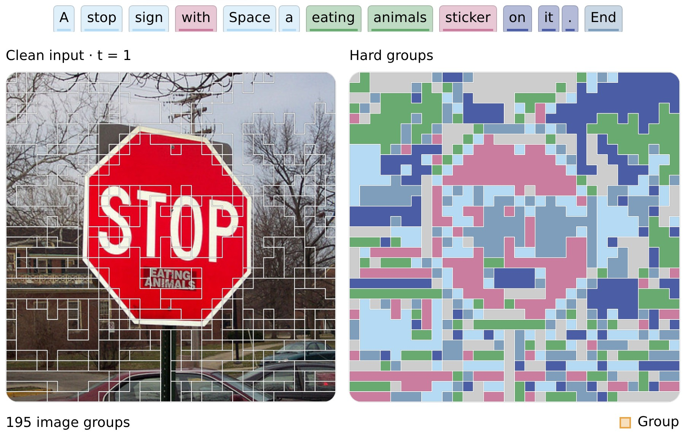

<p align="center">
  <picture>
    <source media="(prefers-color-scheme: dark)" srcset="assets/readme/hit-mark-dark.svg">
    
  </picture>
</p>

<h1 align="center">HiT: Hierarchical Diffusion Transformer<br>for End-to-End Image Generation</h1>

<p align="center">
Xiaoyu Wu¹ · Yifei Wang² · Weihang Guo² · Chen Wei² · Lydia E. Kavraki² · Niloofar Mireshghallah¹ · Zhiwei Steven Wu¹<br>
¹Carnegie Mellon University · ²Rice University
</p>

<p align="center">
  <a href="https://arxiv.org/abs/2611.22962"></a>
  <a href="https://nicholas0228.github.io/blog/hit/"></a>
  <a href="https://huggingface.co/Nicholas0228/HiT"></a>
  
</p>

<p align="center">
  
</p>
<p align="center"><sub>ImageNet 256×256 samples generated by HiT-XL/16, directly in pixel space.</sub></p>

HiT learns visual representations and image generation in one end-to-end pixel-space training stage,
without a pretrained visual encoder. It progressively groups related tokens and represents each group with
a single token. The main Transformer bottleneck processes these compact group tokens, and ungrouping
restores features to their image positions. A compression budget regulates the average compression across
the batch, so group memberships and counts vary across images and diffusion timesteps.

- **1.48 FID** on ImageNet 256×256 (HiT-XL/16, 600 epochs).
- JiT-level quality with about **40%** of its cumulative training FLOPs.
- Text-to-image: above UniLiP-3B's average score on five benchmarks with about 6× fewer denoiser parameters
  and 3× fewer forward FLOPs.
- Groups of coherent objects and object parts emerge without segmentation labels; caption words join the
  image patches that depict them without region annotations.

## Contents

- [Visual results](#visual-results)
- [Models and results](#models-and-results)
- [Quick start](#quick-start)
- [Repository structure](#repository-structure)

## Visual results

More interactive examples are on the [project page](https://nicholas0228.github.io/blog/hit/).

### Better image quality, fewer training FLOPs

<p align="center"></p>
<p align="center"><sub>ImageNet 256×256, FID-50K against training updates (top) and estimated training FLOPs (bottom).
HiT-XL/16 uses group guidance at CFG 2.6; JiT-H/16 uses CFG 2.4. At FID ≈ 2.16, HiT needs about 2.3× fewer
updates and 2.4× less training compute. The star is the final 600-epoch result with the time-shifted sampler.</sub></p>

### HiT learns its own visual hierarchy

<p align="center"></p>
<p align="center"><sub>Level-1 and level-2 groups of HiT-XL/16 at diffusion time t = 0.25, drawn on generated samples.
Group memberships and counts adapt to each image and diffusion timestep.</sub></p>

- **Test-time image grouping.** Groups can follow object parts, merge background regions or connect
  distant patches.
- **A learned router.** A complete average-linkage tree over learned query/key similarities is cut at a
  calibrated threshold. Soft pooling and ungrouping keep everything differentiable. No segmentation labels.
- **A budget, not a quota.** A small budget loss keeps the average compression near 2× per level;
  individual images use more or fewer groups.

### Groups of groups

<table>
  <tr>
    <td width="42%"></td>
    <td>
      HiT builds a hierarchy for each image. <b>Group</b> combines tokens and <b>Ungroup</b> restores
      token positions.
      <br><br>
      Level 1 groups the full token sequence after the first Transformer. Inside it, level 2 groups the
      groups again, and the L core Transformer blocks run at this small, fixed token count. Each
      level ends with Ungroup and adds a learned skip projection (W₂ inside, W₁ outside) before the next
      Transformer.
      <br><br>
      <sub>The numbers are the token counts at each level for one text-to-image example
      (261 → 74 → 57; counts include image and caption tokens).</sub>
    </td>
  </tr>
</table>

### Images and words, one hierarchy

<p align="center"></p>
<p align="center"><sub>The text-to-image HiT groups image patches and caption words in the same hierarchy; word colors
show their groups. These connections emerge without word–region annotations. Caption padding stays outside
the hierarchy, and the timestep travels as one token that never enters a group.</sub></p>

## Models and results

| Experiment | Models | Data | Guide |
|---|---|---|---|
| Class-conditional ImageNet 256² | JiT-B/L/H/16 baselines and HiT-B/L/XL/16 | ImageNet-1k | [Recipe](docs/RECIPE.md) |
| Text-to-image 512² | MiniT2I-B/16 baseline and HiT-B/16 | CC12M with LLaVA-NeXT captions, FLAN-T5-Large | [Text-to-image](docs/T2I.md) |

| Size | JiT | HiT | Recipe |
|---|---|---|---|
| B/16 | [12 blocks](configs/models/jit_b16.json) | [3/3/6/3/3](configs/models/hnet_b16_d18.json) | [config](configs/training/imagenet_80ep.json) |
| L/16 | [24 blocks](configs/models/jit_l16.json) | [3/3/24/3/3](configs/models/hnet_l16_d36.json) | [config](configs/training/imagenet_80ep_l.json) |
| XL/16 | [JiT-H/16, 32 blocks](configs/models/jit_h16.json) | [10/10/8/10/10](configs/models/hnet_xl16.json) | [config](configs/training/imagenet_600ep_xl.json) (600 epochs) |

GFLOPs follow JiT's convention: the forward cost of one image, counting one multiply-add as one operation,
with HiT at its target group counts.

**ImageNet 256×256, official ADM FID-50K**:

| Model | Params | GFLOPs | Epochs | FID-50K ↓ | Checkpoint | Sampling |
|---|---:|---:|---:|---:|---|---|
| JiT-H/16 | 953M | 182 | 600 | 1.86 | — | — |
| HiT-XL/16 | 959.5M | 176.9 | 600 | **1.48** | [Hugging Face](https://huggingface.co/Nicholas0228/HiT) | [script](scripts/evaluate_imagenet.py), [config](configs/sampling/hit_xl16_e600.json) |

**Scaling at 80 epochs** (FID-50K):

| Size | JiT | GFLOPs | FID ↓ | HiT | GFLOPs | FID ↓ |
|---|---|---:|---:|---|---:|---:|
| B | JiT-B, 131.1M | 25.2 | 10.37 | HiT-B, 133.9M | 22.2 | **6.61** |
| L | JiT-L, 458.9M | 87.9 | 4.85 | HiT-L, 463.6M | 55.6 | **4.16** |
| H / XL | JiT-H, 952.5M | 181.9 | 4.39 | HiT-XL, 959.5M | 176.9 | **3.64** |

**Text-to-image 512×512**:

| Model | Params (B) | GFLOPs | GenEval | DPG | PRISM | CoRe | Spatial | Avg. |
|---|---:|---:|---:|---:|---:|---:|---:|---:|
| MiniT2I-B/16 | 0.26 | 201.6 | 87.50 | 84.10 | 55.60 | 44.00 | 52.00 | 64.64 |
| UniLiP-3B | 1.60 | 408.0 | 90.30 | 83.40 | 58.50 | 45.00 | 51.60 | 65.76 |
| **HiT-B/16** | 0.25 | 139.4 | 87.78 | **85.33** | **58.62** | **45.22** | **52.68** | **65.93** |

MiniT2I-B/16 numbers are as reported by [MiniT2I](https://github.com/Hope7Happiness/minit2i-torch).
HiT-B/16: [checkpoint](https://huggingface.co/Nicholas0228/HiT), [generation and scoring](docs/BENCHMARKS.md).
It is fine-tuned for 40k updates after pretraining; the code and three-source data recipe are in
[FINETUNING.md](docs/FINETUNING.md).

## Quick start

Install PyTorch **2.5.1** / torchvision **0.20.1** for your CUDA, then
`pip install -r requirements.txt`.

### Sample and evaluate HiT-XL/16

Download the checkpoint from [Hugging Face](https://huggingface.co/Nicholas0228/HiT) and run

```bash
hf download Nicholas0228/HiT ImageNet256/HiT-XL16_ep600/model.safetensors --local-dir checkpoints
torchrun --standalone --nproc-per-node=8 scripts/evaluate_imagenet.py \
  --checkpoint checkpoints/ImageNet256/HiT-XL16_ep600/model.safetensors --model configs/models/hnet_xl16.json \
  --sampling configs/sampling/hit_xl16_e600.json --count 50000 \
  --output runs/hit-xl16-e600-fid50k \
  --adm-assets "$ADM_ASSETS" --adm-python "$ADM_PYTHON"
```

This should reproduce FID-50K **1.48**. `$ADM_ASSETS` and `$ADM_PYTHON` point to the
[official ADM evaluator](evaluation/README.md).

### Text-to-image benchmarks

Download the checkpoint from [Hugging Face](https://huggingface.co/Nicholas0228/HiT),
then generate each benchmark (`geneval`, `dpg`, `prism`, `corebench`, `spatial_geneval`) and score it with
the pinned scorers as in [docs/BENCHMARKS.md](docs/BENCHMARKS.md):

```bash
hf download Nicholas0228/HiT T2I512/HiT-B16_sft40k/model.safetensors --local-dir checkpoints
torchrun --standalone --nproc-per-node=8 scripts/benchmarks/generate.py --benchmark geneval \
  --checkpoint checkpoints/T2I512/HiT-B16_sft40k/model.safetensors --encoder-root "$FLAN_T5_LARGE" \
  --assets "$ASSETS" --output-root runs/t2i-benchmarks
```

This should reproduce GenEval 87.78, DPG 85.33, PRISM 58.62, CoRe 45.22 and Spatial 52.68 (average 65.93).

### ImageNet training

Use an existing ImageNet cache (or `--data-format folder` with an ImageFolder) and
configure the [official ADM evaluator](evaluation/README.md):

```bash
torchrun --standalone --nproc-per-node=4 main_jit.py \
  --model configs/models/hnet_b16_d18.json \
  --training configs/training/imagenet_80ep.json \
  --runtime configs/runtime/cuda.json \
  --data "$IMAGENET_CACHE" --data-format cached \
  --output "$RUN_DIR" \
  --adm-assets "$ADM_ASSETS" --adm-python "$ADM_PYTHON"
```

80 epochs, global batch 1,024, LR 2e-4 with five warmup epochs, EMA 0.9999. Training writes official
ADM FID-5K every five epochs and FID-50K at epochs 20/40/60/80, with and without CFG.

### Text-to-image

The commands below run 250k-update CC12M pretraining. Continue with the
[SFT40k guide](docs/FINETUNING.md) for the three-source mixture and 40k fine-tuning stage.

The training data is MiniT2I's. [Nicholas0228/minit2i-frozen-inputs-v1](https://huggingface.co/datasets/Nicholas0228/minit2i-frozen-inputs-v1)
holds the same data, frozen only to reproduce our training sequence (caption table, sample order and COCO
evaluation inputs); images and the text encoder come from their original repositories.

```bash
# 1. Inputs: pinned CC12M shards, FLAN-T5-Large, frozen captions/order/COCO assets (~1.2 TB).
python scripts/fetch_t2i_inputs.py --output "$T2I_INPUTS" --token-file ~/.config/hf/token

# 2. Train HiT-B/16 (or configs/t2i/models/minit2i_b16.json for the dense baseline).
torchrun --standalone --nproc-per-node=8 main_t2i.py \
  --model configs/t2i/models/hit_b16_d27.json \
  --inputs "$T2I_INPUTS/inputs.json" --output "$RUN_DIR" --microbatch 128

# 3. Evaluate any saved checkpoint (COCO FID; any GPU count gives the same cohort and noise).
torchrun --standalone --nproc-per-node=8 scripts/evaluate_t2i.py \
  --checkpoint "$RUN_DIR/checkpoints/checkpoint-u0250000.pt" --inputs "$T2I_INPUTS/inputs.json" \
  --count 30000 --ema 0.99995 --output "$RUN_DIR/coco30k-u250000"
```

250k updates at global batch 1,024, LR 4e-4 after a 5k warmup, EMAs 0.99995 and 0.9995, COCO FID-10k
every 10k updates and FID-30k at milestones. The HiT thresholds are already calibrated. Data order and
noise are fixed per sample. Use 8 × 128 or 16 × 64 without accumulation to retain the full-batch
HiT budget objective. Add `--resume` to continue a run.
The [text-to-image guide](docs/T2I.md) has the full recipe, outputs and options.

Both experiments are config-driven: architecture in `configs/*/models`, recipe in `configs/*/training`,
kernels and precision in `configs/*/runtime`, ImageNet samplers in `configs/sampling`. The released
baselines are kept recognizable: upstream
[JiT](https://github.com/LTH14/JiT/tree/cbc743a2ada5e9762697da2c83f8c4f8379e8c17) for ImageNet and the
pinned [MiniT2I PyTorch model](third_party/minit2i_torch/SOURCE.json) for text-to-image.

## Repository structure

| File / guide | Purpose |
|---|---|
| [hnet/model.py](hnet/model.py), [hnet/grouping.py](hnet/grouping.py) | ImageNet hierarchy; Group, Ungroup and budgets |
| [t2i/model.py](t2i/model.py) | MiniT2I baseline and HiT joint image/caption grouping |
| [denoiser.py](denoiser.py), [t2i/diffusion.py](t2i/diffusion.py) | Objectives and samplers, including group guidance and the time shift |
| [scripts/evaluate_imagenet.py](scripts/evaluate_imagenet.py), [configs/sampling](configs/sampling) | Sample and score a saved ImageNet checkpoint |
| [scripts/benchmarks](scripts/benchmarks), [Benchmarks](docs/BENCHMARKS.md) | Generate and score GenEval, DPG, PRISM, CoRe and Spatial |
| [Recipe](docs/RECIPE.md), [Text-to-image](docs/T2I.md) | Model sizes, training, recovery, calibration |
| [Fine-tuning](docs/FINETUNING.md) | SFT40k training and the BLIP3o / DALL-E 3 / ShareGPT-4o mixture |

## Citation

If you find our work helpful, we would appreciate it if you could cite our paper:

```bibtex
@article{wu2026hierarchical,
  title={Hierarchical Diffusion Transformer for End-to-End Image Generation},
  author={Wu, Xiaoyu and Wang, Yifei and Guo, Weihang and Wei, Chen and Kavraki, Lydia E and Mireshghallah, Niloofar and Wu, Steven},
  journal={arXiv preprint arXiv:2611.22962},
  year={2026}
}
```

## License

MIT for this code and the [checkpoints](https://huggingface.co/Nicholas0228/HiT). The frozen text-to-image inputs
([dataset](https://huggingface.co/datasets/Nicholas0228/minit2i-frozen-inputs-v1)) are CC BY-SA 4.0, as their
captions are. Vendored components keep their own licenses:
[MiniT2I](third_party/minit2i_torch/LICENSE) (MIT) and SciPy-derived linkage
([BSD-3](LICENSES/scipy-bsd.txt)). The figures in `assets/readme` come from the
[project page](https://nicholas0228.github.io/blog/hit/).
